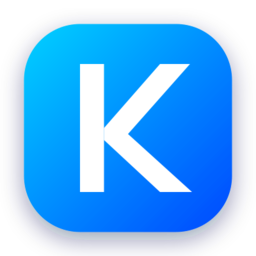

<p align="center">
  
</p>

<h1 align="center">Kora Language Support for Visual Studio Code & Modern IDEs</h1>

<p align="center">
  <strong>The official development environment for the Kora programming language and framework.</strong>
</p>

<p align="center">
  <a href="https://open-vsx.org/extension/kora-framework/kora-vscode"></a>
  <a href="https://github.com/Hwai-technology/kora-framework/releases"></a>
  <a href="https://github.com/Hwai-technology/kora-framework/blob/main/LICENSE"></a>
  
</p>

---

## 🌟 Overview

**Kora** is a high-throughput, memory-safe backend language and web framework that unifies the developer ergonomics of **TypeScript**, the raw speed and zero-cost abstractions of **Rust**, and the actor/channel concurrency model of **Go**.

This extension turns **Visual Studio Code**, **Cursor**, **VSCodium**, and **Antigravity IDE** into a first-class Kora IDE with real-time compilation feedback, rich language intelligence, and domain-driven design tooling.

---

## 🚀 Key Features

### 1. ⚡ Real-Time Compiler Diagnostics & Architectural Linting
- **Continuous Background Validation**: Instant syntax and type-checking with intelligent debouncing (`350ms`) as you type.
- **Clean Architecture Rules**: Enforces clean layer boundaries (`E5001`–`E5004`) directly in the editor, alerting you when controllers bypass service interfaces or leak database abstractions.

### 2. ▶ Interactive CodeLens Execution
- **One-Click Native Execution**: Interactive `▶ Run File` and `⚡ Check File` action buttons appear directly above `fn main()` and top-level entrypoints.
- Runs your application in the integrated terminal without manually typing commands.

### 3. 🎨 Canonical Code Formatting (`Shift+Alt+F`)
- **Built-in Formatter**: Registered `DocumentFormattingEditProvider` backed by `kora fmt`.
- Supports `editor.formatOnSave: true` for zero-configuration, deterministic, team-wide code formatting.

### 4. 🔍 Go To Definition (`F12` / `Ctrl+Click`)
- **Instant Symbol Navigation**: Jump directly to declarations of `model`, `class`, `interface`, `enum`, `fn`, `let`, and `var`.
- Seamlessly resolves multi-file imports (`import { UserService } from "./services/user_service"`).

### 5. 📑 Document Symbols & Outline View (`Ctrl+Shift+O`)
- **Hierarchical Code Outline**: Renders a complete structural hierarchy of your models, services, methods, and types in the side outline and editor breadcrumbs.

### 6. 💡 Contextual Hover Documentation
- Hover over any language keyword, built-in primitive (`Int`, `Float`, `String`, `Option`, `Result`), decorator (`@entity`, `@unique`, `@index`), or actor construct to view rich Markdown documentation with usage examples.

### 7. ✨ Intelligent Autocompletion & Snippets
- Context-aware suggestions for keywords, types, REST route handlers (`get()`, `post()`, `put()`, `delete()`), concurrency primitives (`spawn`, `channel`, `broadcast`), and ORM decorators.
- Rapid snippet templates: type `class`, `model`, `actor`, `enum`, or `test` and hit `Tab`.

### 8. 📁 Domain-Driven File Icon Theme
- Includes **19 custom vector icons** tailored for clean architecture files:
  - `*.entity.kora` — Database Entity
  - `*.dto.kora` — Request/Response DTO
  - `*.service.kora` — Domain Service
  - `*.controller.kora` — HTTP Controller / Router
  - `*.repository.kora` — Database Repository
  - `*.validator.kora` — RFC Input Validator
  - `*.test.kora` — Lifecycle Test Suite
  - `*.event.kora` — Domain Event
  - And more (`module`, `middleware`, `config`, `enum`, `interface`, `routes`).

---

## 📖 Kora Syntax at a Glance

### Clean Architecture & Data Transfer Objects
```kora
// models/user.dto.kora
model CreateUserDto {
    name: String,
    email: String,
    role: String
}

// entities/user.entity.kora
@entity
@table("users")
model User {
    @id @auto
    id: Int,
    @index
    name: String,
    @unique
    email: String,
    active: Bool
}
```

### Services & Interfaces
```kora
// interfaces/user_service.interface.kora
interface IUserService {
    fn register(dto: CreateUserDto) -> Result<User, String>
}

// services/user.service.kora
class UserService implements IUserService {
    repo: IUserRepository

    init(repo: IUserRepository) {
        this.repo = repo
    }

    fn register(dto: CreateUserDto) -> Result<User, String> {
        let user = User {
            id: 0,
            name: dto.name,
            email: dto.email,
            active: true
        }
        return this.repo.save(user)
    }
}
```

### High-Throughput Concurrency & Actors
```kora
// Concurrency with async channels and actors
fn main() {
    let chan = channel<String>(100)

    spawn(async () => {
        chan.send("Message from worker task")
    })

    let message = chan.recv()
    println("Received: {}", message)
}
```

---

## ⌨️ Commands & Shortcuts

| Command | Title | Default Shortcut |
|---|---|---|
| `kora.runFile` | **Kora: Run File** | `F5` / Context Menu |
| `kora.checkFile` | **Kora: Check File** | Context Menu |
| `kora.formatFile` | **Kora: Format Document** | `Shift+Alt+F` |

---

## ⚙️ Configuration Settings

Access settings via `Ctrl+,` (or `Cmd+,` on macOS) and search for `kora`:

```json
{
  // Custom path to the kora compiler binary (default: "kora" in PATH)
  "kora.compilerPath": "kora",

  // Enable or disable real-time compiler diagnostics and architectural checks
  "kora.enableDiagnostics": true,

  // Debounce delay (in ms) before triggering real-time diagnostics
  "kora.debounceMs": 350,

  // Automatically format .kora and .kr files on save
  "kora.formatOnSave": true
}
```

---

## 💻 Installation

### Option 1: Open VSX Registry (VSCodium, Cursor, Antigravity IDE, Gitpod)
Search for **Kora Language Support** in the Extensions view (`Ctrl+Shift+X`), or install via CLI:
```bash
ovsx get kora-framework.kora-vscode
```

### Option 2: Visual Studio Marketplace (VS Code)
Search for **Kora Language Support** by **kora-framework** in the Extensions sidebar.

### Option 3: Install from VSIX package
Download `kora-vscode-0.8.0.vsix` from [GitHub Releases](https://github.com/Hwai-technology/kora-framework/releases) and run:
```bash
code --install-extension kora-vscode-0.8.0.vsix
```

---

## 🤝 Community & Support

- **Repository**: [https://github.com/Hwai-technology/kora-framework](https://github.com/Hwai-technology/kora-framework)
- **Official Documentation**: [https://kora-lang.dev](https://kora-lang.dev)
- **Bug Reports & RFCs**: [https://github.com/Hwai-technology/kora-framework/issues](https://github.com/Hwai-technology/kora-framework/issues)

---

<p align="center">
  Distributed under the <a href="./LICENSE">GNU Affero General Public License v3.0 or later</a>.
</p>
